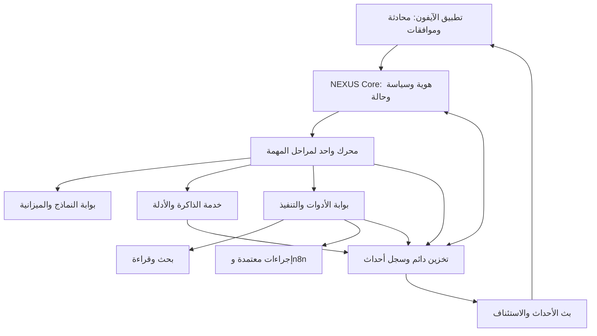

# NEXUS ONE — استخلاص معماري موحّد من المرفقات

تاريخ المراجعة: 3 نوفمبر 2026. الحالة: مقترح تصميم، وليس إعلان بناء أو تشغيل أو اعتماد نهائي.

## النتيجة

نواة تحكم واحدة تملك الحالة والصلاحيات والموافقات والميزانية؛ محرك تنسيق واحد يدير مراحل المهمة؛ أدوات قابلة للاستبدال خلف بوابة تنفيذ؛ ذاكرة موثقة؛ وتطبيق آيفون يعرض الأحداث الحقيقية. المشهد السينمائي تمثيل لحالة النظام، ولا يمنح صلاحية أو يثبت نجاح عملية.

هذا الاستخلاص يحافظ على القيمة المشتركة بين الملفات ويحل تعارضاتها. لا يفترض أن كل ما كُتب فيها مُنفّذ، ولا أن الأسماء والإصدارات والأرقام المذكورة اختُبرت على جهاز المستخدم.

## 1. ما يفيدنا من كل مصدر

| المصدر | القيمة التي نحتفظ بها | القيد أو التصحيح |
|---|---|---|
| دستور المشروع، PDF، 1 نوفمبر | عقد الإجراء الموقّع، nonce، منع تكرار الأثر، حالة UNKNOWN_HALTED، الفصل بين توجيهات المالك والمحتوى الخارجي | العربية مفقودة بصرياً وفي الاستخراج في الصفحات الخمس؛ الاعتماد فقط على الكود والجداول اللاتينية المقروءة. نجاح 9/9 و53 اختباراً ادعاء داخل الملف، لم يُعاد إثباته |
| تقرير معمارية الوكيل الشخصي، نسخة Markdown داخل ZIP | نواة رفيعة مع مكونات جاهزة؛ n8n أداة؛ الأحداث واجهة ربط مستقلة | لا نأخذ اقتراح جمع Hermes وPydantic AI وLangGraph كمحركات متوازية، ولا قناة Telegram بديلاً مفروضاً عن الآيفون |
| مراجعة أدلة وكيل البحث، Markdown داخل ZIP | الذاكرة قبل البحث، سجل أدلة، التوقف قبل دمج النتائج، التحقق قبل الحفظ، عمق بحث وميزانية محددان | قيد «قارئ فقط» يخص مسار البحث. لا يعمم على المنتج التنفيذي كله. المحكمة متعددة النماذج اختيار يحتاج قياساً |
| Sovereign Flagship Blueprint | إعادة الاتصال، حفظ محلي، عقود رسائل، عرض فرق التعديل، الموافقة على الإجراء، فصل تجربة العرض عن الخدمة | الكود يتضمن محاكاة وبيانات ثابتة وعيوب موافقة واستئناف؛ وصف Production Release لا يثبت الجاهزية |
| حقيبة تطوير iOS | فصل خدمات الصوت والاتصال والعرض؛ RTL؛ نظام تصميم؛ شيدر قابل لإعادة الاستخدام | ليست تطبيقاً متكاملاً؛ يوجد مكوّن TSX وشيدر مع صور ووثائق. لا يوجد في الحقيبة مشروع Expo كامل بحزم وخادم |
| dream-vault | سجل قرارات وتفضيلات وكيانات؛ الصدق في تمييز الحقيقي من المحاكاة؛ ملفات قابلة للنقل | ذاكرة تاريخية تحتاج تاريخاً ومصدراً؛ لا تثبت الحالة الحالية للمستودع أو الأجهزة أو الحسابات |
| design-system-builder | توحيد الألوان والخطوط والمسافات والمكونات وحالات الواجهة | قوالب عمل تصميمية، لا محرك وكلاء ولا نظام صلاحيات. تعليماتها الداخلية ليست أوامر تنفيذ لهذه المراجعة |
| PDF تقرير المعمارية | نسخة عرض للموضوع نفسه | العربية غير مقروءة؛ استُخدمت نسخة Markdown داخل أرشيف التقرير بدلاً منها |

## 2. المعمارية المقترحة

هذه حدود مسؤوليات داخل تطبيق خادم معياري، وليست مطالبة ببناء خدمة مستقلة لكل صندوق.

| الجزء | مسؤوليته الحصرية | ما لا يملكه |
|---|---|---|
| تطبيق الآيفون | النص والصوت والملفات، بطاقات القرار، متابعة المهام، مخبأ محلي | مفاتيح المزودين الدائمة أو إعلان نجاح التنفيذ من عنده |
| NEXUS Core | تعريف المالك والجهاز، السياسة، عقد المهمة، التحكم في الميزانية، قبول القرارات | تنفيذ نصوص أوامر النموذج بلا فحص |
| محرك المهمة | التخطيط، استدعاء النموذج، مراحل البحث، الانتظار والاستئناف، تفويض محدود | تجاوز بوابة الأدوات أو منح نفسه صلاحية |
| Model Gateway | اختيار المزود ضمن القائمة المسموحة وحجز الإنفاق وتسجيل الاستخدام | تحويل اشتراكات الشات تلقائياً إلى رصيد API |
| Memory Service | استخراج واسترجاع الحقائق مع المصدر والوقت والتصحيح | رفع نص من موقع خارجي إلى تعليمات مالك |
| Tool/Action Broker | التحقق من المدخلات والصلاحيات، عرض الإجراء، الاعتماد، التوزيع، تسجيل الإيصال | تفسير ثقة النموذج كإذن تنفيذ |
| Event Stream | بث أحداث محفوظة وإعادة إرسال الفائت | تخزين الحقيقة الوحيدة داخل اتصال WebSocket |

## 3. حسم الاختيارات المتعارضة

**التركيب التقني المرجّح لهذا التصميم:** React Native/Expo Development Build للآيفون؛ TypeScript/Fastify للنواة؛ LangGraph JS محرك مراحل واحد؛ SQLite في نشر أولي على مضيف واحد؛ ملفات للمواد الأصلية. هذه اختيارات تصميمية، لا نتيجة فحص للمستودع الحالي.

اختيار LangGraph JS يحافظ على مسار TypeScript المذكور ويستعير التوقف والاستئناف بدل إعادة بناء منسق كامل. توثيقه الرسمي يثبت interrupt مع checkpointer دائم وthread_id. يجب إثبات توافق التخزين المختار عملياً؛ لا يكفي وضع المكتبة في الرسم.

**مكان Hermes:** ليس مطلوباً معه تشغيل محرك رئيسي ثانٍ. يمكن تقييمه لاحقاً كبديل خلف واجهة RuntimeAdapter، أو كعامل محدود بلا سلطة مباشرة. استبداله بمحرك آخر لا يغير عقد المهمة أو مالك الذاكرة أو بوابة الأفعال. هذه نقطة قرار مقترحة وليست تغييراً منفذاً لخطة قديمة.

**مكان n8n:** تنفيذ workflows محددة خلف البوابة. الطلب الذي يصل من جدولة أو webhook يمر بسياسة النواة أيضاً. لا صلاحية ضمنية لأنه وصل من أتمتة. لا تفعيل لأي جدول قديم في هذا العمل.

**مكان MCP:** محوّل تكامل عندما يدعمه المزود. يبقى HTTP adapter مشروعاً للتكاملات التي تحتاجه؛ فرض تحويل كل خدمة إلى MCP يضيف تعقيداً غير لازم. تعريفات الأداة وreadOnlyHint ليست ضمان صلاحية.

**مكان ACP وGit Worktrees:** خاص بمسار البرمجة عند إضافته. مساحة العمل العامة للبحث أو البريد ليست Git worktree. وكلاء الكود يُعزلون بنظام صلاحيات وبيئة تنفيذ؛ إنشاء worktree وحده لا يحقق العزل الأمني.

**مكان المشهد السينمائي:** طبقة عرض اختيارية تتبع الأحداث. تعطلها لا يوقف البحث أو القرار. يبقى بديل عرض بسيط متاحاً.

## 4. دورة المهمة ونقاط التحكم

1. يستقبل Core الطلب الأصلي ويحفظه دون استبداله بملخص؛ يحدد المهمة ونسختها وحدود التكلفة والوقت.
2. تُسترجع ذاكرة ذات صلة مع مصادرها وأعمارها. المعلومات القديمة تُعامل كقديمة، لا كحالة تشغيل حية.
3. يختار المحرك مساراً سريعاً أو بحثاً أعمق. المسار السريع لا يتجاوز الأمان أو مراجعة الحداثة عند الحاجة.
4. تُجمع نتائج البحث عبر أداة نملك مسارها، ثم تحفظ كمواد خارجية غير موثوقة.
5. يمكن التوقف قبل تمرير نتائج البحث إلى نموذج التوليف، وقبل الدمج، وقبل صياغة الرد؛ نقاط البحث اختيارية حسب إعداد المهمة.
6. ينتج التحقق ادعاءات مرتبطة بمقاطع مصادر، وفجوات وخلافات معلنة. الاتفاق بين النماذج لا يعادل دليلاً.
7. عند الحاجة لأثر خارجي، تُنشأ ActionProposal محددة. البوابة تحدد هل توجد صلاحية سابقة كافية أم يلزم قرار جديد.
8. بعد الإذن الصحيح تُحفظ نية الإرسال ثم ينفذ المحوّل، ويُسجل إيصال الخدمة قبل إعلان النجاح.
9. يُحفظ الناتج وملخص القرار والأدلة؛ يمكن استئناف المهمة من حالة دائمة بعد الانقطاع.

التوقف قبل نتائج أداة يديرها مزود النموذج داخلياً لا نفترض توفره. لتحقيق التحكم الدقيق نجمع البحث بأداة منفصلة ونجعل إدخاله للنموذج مرحلة صريحة.

ما تعرضه الواجهة هو الخطة، الأدوات، المصادر، أسباب القرارات المختصرة، والتكلفة والحالة؛ وليس ادعاء كشف التفكير الداخلي الخام للنموذج.

## 5. عقود تمنع الانفصال بين المكونات

| العقد | الحقول الأساسية |
|---|---|
| Task | task_id، owner_id، original_request_ref، revision، status، runtime_version، policy_version، budget_limit، deadline |
| ActionProposal | action_id، task_id، tool_id، tool_schema_hash، target_account، destination، parameters، attachment_hashes، payload_hash، revision |
| Approval | approval_id، action_id، approved_payload_hash، device_id، decision، scope، expires_at، nonce، proof |
| Execution | execution_id، action_id، idempotency_key، dispatch_state، provider_operation_id، receipt_ref، timestamps |
| Evidence | evidence_id، source_uri، captured_at، content_hash، excerpt_location، trust_label |
| Claim | claim_id، statement، evidence_ids، verification_status، valid_at، expires_at، supersedes |
| Event | event_id، task_id، sequence، type، timestamp، payload_version، payload، execution_id الاختياري |

تغيير الوجهة أو النص أو الملف أو الحساب بعد الموافقة يلغي مطابقة الموافقة. تحتاج النسخة المعدلة قراراً جديداً إذا كانت السياسة تشترط الموافقة.

نافذة صلاحية إثبات الموافقة مستقلة عن عمر مهمة قد تستغرق ساعات. لا يُستخدم قيد 120 ثانية من المثال كمهلة للمهمة كلها.

حالات الإجراء: PROPOSED ثم AWAITING_APPROVAL عند اللزوم، ثم APPROVED ثم DISPATCHING ثم SUCCEEDED أو FAILED. وتوجد REJECTED وEXPIRED وCANCELLED. عند غياب اليقين بعد الإرسال نستخدم UNKNOWN_HALTED ثم مصالحة مع الخدمة؛ لا نعيد فعلاً مؤثراً عميانياً.

منع التكرار محلياً لا يثبت exactly-once عبر شبكة وخدمة خارجية. نسجل مفاتيح التنفيذ ونستفيد من idempotency لدى المزود حين تتوفر، ونتحقق من العملية حين تضيع الاستجابة.

## 6. الذاكرة والتخزين والاستمرارية

نبدأ بمصدر حقيقة تشغيلي واحد للمهمة والإجراء والموافقة والميزانية. يحتفظ محرك المراحل بـ checkpoints في نطاقه، ويربطها بـ task_id؛ لا تكون موافقة checkpoint بديلاً عن سجل موافقات البوابة.

الجداول المنطقية: tasks، checkpoints، actions، approvals، executions، events، budget_reservations، claims، evidence، memory_revisions، devices. المواد الأصلية في مخزن ملفات مع hashes. يدار انتقال الحالة وتسجيل الحدث في معاملة واحدة حيثما يلزم، ويُقرأ البث من الأحداث المحفوظة.

SQLite اختيار مبدئي لمضيف واحد مع نسخ احتياطي واختبار استعادة وإعدادات durability مناسبة. الانتقال إلى PostgreSQL قرار توسع عند تعدد العمال أو المضيفين، لا شرط بداية. WAL وحده ليس ضماناً شاملاً ضد فقد الطاقة أو فساد التخزين.

نبدأ ببحث نصي وفلاتر دقيقة؛ تضاف embeddings وإعادة ترتيب عندما يثبت التقييم حاجة. لا حاجة إلى Supabase وObsidian وMem0 معاً كمالكين متساويين للذاكرة. يمكن تصدير Markdown إلى Obsidian كعرض قابل للقراءة.

عند انقطاع الهاتف تستمر المهمة على الخادم. يعود العميل بـ last_event_id ويحصل على الأحداث الفائتة. طابور الهاتف يحفظ المسودات والطلبات غير المؤكدة؛ لا يحذف الأقدم بصمت عند الامتلاء، ولا يعيد موافقات منتهية.

## 7. نتائج فحص الكود ذات الأثر المعماري

| الموضع في المرفق | الملاحظة المباشرة | أثرها في التصميم |
|---|---|---|
| Blueprint: mac-acp-worktree-server.ts | يختار trading ثابتاً ويرسل نص Executed؛ أسماء الأدوات مصفوفة نصية دون استدعاء | لا يُحتسب كتكامل Composio أو وكيل أو n8n شغّال |
| نفس الخادم | processedIdempotencyKeys داخل Set بالذاكرة، ويُضاف المفتاح قبل إثبات النجاح | سجل دائم بحالة ونتيجة، ورد واضح للطلب المكرر |
| Blueprint: processVoiceCommandThroughJevAndRoute | يعرض pendingHumanApproval ثم يرسل session/prompt دون توقف | التنفيذ محظور في البوابة حتى مطابقة الاعتماد، لا مجرد بطاقة ظاهرة |
| Blueprint: approveWorktreeRequest | يعرض التنفيذ الناجح ويزيد عداد الذاكرة قبل إيصال الخادم | الموافقة حدث مختلف عن التنفيذ والنجاح |
| Blueprint: JevProbabilisticEngine | درجات مبنية على مطابقة أول أربعة أحرف ثم softmax | ليست احتمالات معايرة، ولا دليل على سرعة 140ms أو وفورات 193x/445x |
| Blueprint: lastTokenOffset | يزيد بأرقام ثابتة 64 و120 | استبداله بمؤشر أحداث صادر من الخادم؛ ليس استئنافاً حقيقياً للتوكنز |
| Blueprint: appendToOutboxRingBuffer | removeFirst عند 100 عنصر | فقد أمر محتمل؛ يلزم حد معلن ورفض إضافة أو إدارة مسودات واضحة |
| Blueprint: loadDefaultDronesAndMetrics | أسعار ونتائج ومقاييس وموارد ثابتة | تبقى DEMO معزولة؛ لا تتحول إلى telemetry حقيقية |
| CinematicSky.tsx | running يتغير لكن لا يدخل في uniforms أو شرط العرض، وقيمة الصوت 0.04 ثابتة | تعليق إيقاف الخلفية لا يثبت إيقاف الرسم؛ ولا يوجد RMS حي هنا |

هذا فحص نصي للكود المرفق، لا اختبار ترجمة Swift أو تشغيل iOS. لا تتضمن المرفقات مصدر المستودع الكامل لإثبات حالته الحالية.

## 8. الهوية والصوت والعرض

فتح الواجهة بسهولة لا يعني خادماً بلا هوية. نقترح اقتران جهاز وجلسة محمية، مع تصعيد التحقق حسب خطورة الإجراء. تبقى مفاتيح المزودين في الخادم. لا ننقل مطلب Zero Auth من نموذج بصري إلى واجهة تنفيذ عامة.

توثيق Expo يؤكد أن requireAuthentication في SecureStore غير مدعوم في Expo Go عند توفر المصادقة الحيوية بسبب مفتاح Face ID المفقود؛ لذلك المسار المستهدف Development Build، مع اختبار فعلي على iPhone. لا نفترض أن مكتبة تخزين آمن تمنح تلقائياً توقيعاً بمفتاح Secure Enclave غير قابل للاستخراج.

خدمة الصوت مستقلة: إدخال صوت ثم تفريغ أو جلسة صوت حي حسب المزود، مع النص النهائي كطلب مهمة. مفاتيح جلسة قصيرة العمر إن أتاحها المزود. انقطاع الصوت لا يضاعف إرسال الطلب. اختيار مزود الصوت والمكتبة يُحسم باختبار تكامل، لا بمجرد ذكر LiveKit في قائمة dependencies.

الألوان والحركة وRTL من حقيبة iOS قابلة للاحتفاظ. تعرض الشاشة حالات: جارٍ البحث، يحتاج قراراً، انقطع الاتصال، نتيجة جزئية، اكتمل بإيصال. المحاكاة تحمل علامة صريحة ولا تكتب أحداثاً في سجل الإنتاج.

## 9. شروط قبول المعمارية عند التنفيذ

- تغيير payload بعد الموافقة يرفض التنفيذ.
- إعادة تشغيل الخادم أثناء انتظار موافقة تحفظ الحالة والقرار المطلوب.
- انقطاع الرد بعد أثر خارجي ينتج حالة غير محسومة ومصالحة، لا إعادة تلقائية خطرة.
- رجوع الهاتف يعرض الأحداث الفائتة دون تكرار المهمة.
- تجاوز الميزانية يمنع استدعاءً جديداً مع حجز تكلفة قبل التنفيذ، ويعيد نتيجة جزئية معلنة عند الحاجة.
- النص الخارجي لا يستطيع تغيير السياسة أو منح نفسه أداة.
- لا تظهر SUCCEEDED إلا بدليل تنفيذ ملائم للعملية.
- رفض الموافقة وإلغاؤها يمنع توزيع إجراء لم يبدأ؛ لا يدعي التراجع عن أثر حدث فعلاً.
- اختبار استعادة نسخة احتياطية يعيد مهاماً وأدلة وموافقات مترابطة.
- يثبت مسار واحد كاملاً من الآيفون إلى أداة حقيقية ثم إيصال وعرض، قبل توسيع الوكلاء أو المشاهد.

## 10. حدود التحقق والمراجع

لم أعد التحقق من كل أسعار وأبحاث وأرقام CVE وإحصاءات سوق وردت في الدراسات؛ لم تُستخدم كأساس للقرار. كذلك لم أعد فحص GitHub أو حساب n8n أو مواصفات جهاز المستخدم. تعارض «لا Mac» مع ذكريات امتلاك جهاز لا يُحسم من وثيقة قديمة؛ التصميم يقبل مضيفاً خاصاً محلياً أو سحابياً دون اشتراط شراء عتاد.

المراجع الرسمية التي فُحصت في هذه المراجعة:

- [LangGraph JS: Interrupts](https://docs.langchain.com/oss/javascript/langgraph/interrupts): توقف واستئناف مع تخزين دائم ومعرف ثابت.
- [Expo SecureStore](https://docs.expo.dev/versions/latest/sdk/securestore/): قيد المصادقة الحيوية في Expo Go.
- [MCP Tools](https://modelcontextprotocol.io/specification/latest/server/tools): تعريفات الأدوات ليست ضماناً أمنياً؛ تُبنى الصلاحيات في المضيف.

أصول المراجعة: المرفقات الثمانية في هذه المحادثة. الأسماء والدوال المحددة أعلاه إحالات إلى محتوياتها، والقرارات الجديدة موسومة كمقترحات. لا تنفيذ أو تعديل في المشروع ضمن هذا الاستخلاص.