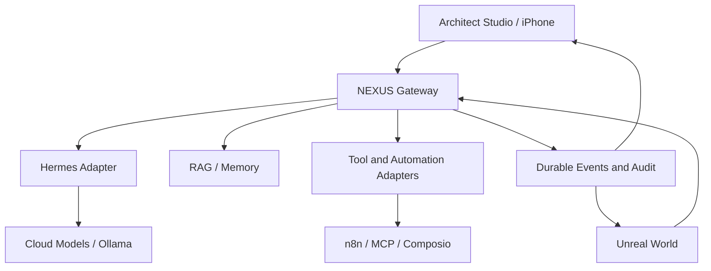

# تحديث حاكم — تنفيذ متوازٍ بإذن أحمد — 21 أكتوبر 2026

طلب أحمد بعد تصحيح الخطة: «بالتوازي ابني الوكيل الاول والتكاملات والوكلاء واضف جميع الذي اتفقنا عليه».

أصبح تنفيذ الخلفية والوكيل الرئيسي والتكاملات والوكلاء مأذونًا الآن بالتوازي مع مسار اختيار وشراء المشهد. يُلغى شرط انتظار شراء وتشغيل المشهد لبدء الخلفية في النسخة السابقة أدناه. يظل العالم أساسه مشهد سينمائي جاهز يُشترى، والربط البصري النهائي يتطلب تشغيل الأصل المعتمد.

تم تحديث الخطة الحاكمة في GitHub: docs/NEXUS_SCENE_FIRST_PLAN.md، وتعليمات CLAUDE.md والحالة STATUS.md. آخر التزام للتصحيح: 3d472a8a985db5eed2476000bdb620dae458c6d5. أُرسلت تعليمات التنفيذ إلى مهمة Codex القائمة وحالتها inProgress؛ لا يُعد ذلك إثبات اكتمال البناء.

نطاق التنفيذ: Hermes، Core Gateway، الوكيل الرئيسي والوكلاء، الأدوات والبحث الحقيقي وMCP/Composio حسب التوفر، الذاكرة وRAG والاستشهادات، Architect Control، وعقود NEXUS CORE وMission Theater وReplay وKnowledge Vault وCamera Intelligence وربط Unreal. n8n وOllama اختياريان، والبريد قراءة فقط. تظل الأتمتات المجدولة السابقة متوقفة. شراء أصل محدد يحتاج اعتماد الأصل والسعر.

مرجع التنفيذ: https://github.com/as1411307-collab/ahemed--agent-v01/blob/main/docs/NEXUS_SCENE_FIRST_PLAN.md

## نسخة التصحيح السابقة — يتغلب عليها التحديث أعلاه عند التعارض

# NEXUS ONE — الخطة المصححة: شراء مشهد سينمائي جاهز ثم بناء الوكلاء عليه

تاريخ التصحيح: 21 أكتوبر 2026 — توقيت الإمارات.
المرجع الحاكم: توجيه أحمد الصريح في هذه المحادثة: «نشتري مشهد سينمائي جاهز ونبني عليه الوكيل والوكلاء».
الحالة: تصحيح وثيقة الخطة فقط. لم يُشتر أصل، ولم يُستأنف تنفيذ أو متابعة مجدولة، ولم يُعدّل GitHub أو تُرسل تعليمات لمهمة Codex.

## 1. القرار الملزم

نشتري بيئة/مشهدًا سينمائيًا ثلاثي الأبعاد جاهزًا وقابلًا للتعديل، نشغّله ونعتمده كأساس NEXUS ONE، ثم نضيف إليه الوكيل الرئيسي والوكلاء المتخصصين وربط مهامهم الحقيقية بالعالم.

المشهد الجاهز هو أساس المنتج وأول تسليم. يبقى Unreal Engine 5 اتجاه العالم المتفق عليه؛ اختيار الأصل المحدد يتطلب إثبات توافقه الفعلي. لا يُعاد بناء المشهد من الصفر، ولا يُستبدل بلوحة تحكم أو فيديو مسجل أو نموذج HTML. نعيد استخدام محرك وكلاء قائم؛ Hermes هو اتجاه التكامل السابق ويُتحقق من نسخته وقدراته عند مرحلة الربط.

## 2. الخطأ المثبت وتصحيحه

الوثيقة السابقة رتبت العمل N01 baseline ثم N02 contracts/config ثم N03 Studio ثم N04 engine ثم N05 integrations ثم N06 cinematic. وذكرت «لا استئجار GPU أو شراء assets الآن».

هذه الصياغة غيّرت ترتيب المنتج: جعلت البنية الهندسية هي البداية، وأسقطت شراء المشهد بوصفه خطوة أساسية، وأخّرت التجربة السينمائية. هذا هو الانحراف المثبت في الوثيقة؛ لا يمثل هذا الفحص مراجعة جديدة للكود أو سجل التنفيذ.

يلغى ترتيب N01–N07 السابق كخطة تنفيذ. تُنقل تفاصيله المفيدة إلى مراحل الربط اللاحقة عند الحاجة فقط، ولا تُستخدم شرطًا لبدء اختيار المشهد وشرائه وتشغيله.

## 3. مراحل التنفيذ المصححة

| الترتيب | المرحلة | المخرج المطلوب | شرط الانتقال |
|---|---|---|---|
| 1 | اختيار مشهد سينمائي جاهز للشراء | أصل محدد مع رابط البائع، سعر موثق عند الاختيار، رخصة، ملفات مشروع قابلة للتعديل، إصدار المحرك ومتطلبات الجهاز | اعتماد أحمد للأصل والسعر؛ التأكد من أنه مشروع تفاعلي مناسب وليس فيديو أو صورًا فقط |
| 2 | شراء المشهد وتشغيله | شراء الأصل المعتمد، تنزيل مشروعه، فتحه وتشغيله في بيئة متوافقة، حفظ نسخة أصلية قبل التخصيص | معاينة فعلية للمشهد وتشغيل موثق على جهاز محدد؛ لا يكفي فيديو إعلان البائع |
| 3 | تهيئة المشهد لـ NEXUS ONE | تخصيص محدود للهوية والكاميرا وموضع NEXUS CORE والتفاعل، مع الحفاظ على جودة المشهد الجاهز | قبول التجربة البصرية والتفاعل الأساسي قبل توسيع البنية |
| 4 | ربط الوكيل الرئيسي | محرك قائم مع طبقة Gateway رفيعة وربط أحداثه بالمشهد؛ مهمة حقيقية واحدة من الطلب إلى النتيجة | المهمة تنفذ فعليًا، والنتيجة وحالة الاتصال ظاهرتان، والموافقات اللازمة تمنع الأثر قبل الإذن |
| 5 | إضافة الوكلاء المتخصصين | أدوار وأدوات محددة، تكليف وتسليم نتائج، تمثيل حالة كل وكيل داخل العالم | مهمة متعددة الوكلاء قابلة للتتبع، مع تمييز المنفذ والمتعثر والمنتظر للموافقة |
| 6 | التوسع وفق الحاجة | Architect Control المتقدم، الذاكرة وRAG والتكاملات والعوالم الإضافية والنشر | تضاف كل قدرة لحاجة فعلية بعد نجاح المشهد والوكيل والوكلاء |

لا تبدأ المرحلة الرابعة قبل نجاح تشغيل المشهد واعتماد أساسه البصري. يمكن إجراء فحص توافق محدود قبل الشراء لتجنب أصل غير مناسب؛ لا يتحول هذا الفحص إلى بناء منصة كاملة أولًا.

## 4. شروط اختيار الأصل

- بيئة ثلاثية الأبعاد جاهزة ومتماسكة بصريًا، مع ملفات قابلة للتحرير وإضافة عناصر وتفاعل.
- رخصة تسمح بالاستخدام المقصود وتعديله ودمجه؛ تُراجع شروط الأصل المحدد قبل الدفع.
- توافق موثق مع إصدار Unreal المستهدف، وقائمة الملحقات والتبعيات اللازمة.
- متطلبات جهاز وتكلفة إجمالية معلومة تشمل الأصل وأي تبعيات لازمة؛ لا افتراض توفر GPU.
- يُختار المشهد الأقرب للمراجع البصرية المعتمدة. SKY SANCTUARY اتجاه بصري أول من التصور الأحدث، وليس ادعاء بوجود أصل جاهز بهذا الاسم أو إلزامًا ببنائه من الصفر.
- أسماء FUTURE MEGACITY وCOSMIC OBSERVATORY اتجاهات توسع لاحقة، ولا يلزم شراء أو بناء ثلاثة عوالم في البداية.
- لم يُحدد أصل للبيع أو سعر أو ميزانية في هذا التصحيح؛ لا يُفهم اعتماد الخطة على أنه موافقة على دفعة غير محددة.

## 5. الربط بعد المشهد

المسار: واجهة العالم → NEXUS Core Gateway → محرك الوكيل القائم → الأدوات والوكلاء؛ تعود أحداث التنفيذ والنتائج إلى العالم.

Gateway يحتفظ بالمصادقة والموافقات وحدود الإنفاق والأسرار وسجل التنفيذ. لا توضع مفاتيح الخدمات داخل المشهد. حركات العالم الزخرفية لا تعني أن مهمة تعمل؛ حالات العمل تستند إلى أحداث فعلية.

n8n تكامل اختياري قابل للاستبدال خلف Core، وليس مكونًا إلزاميًا. لا تُفرض إعادة كتابة Core أو نقل قاعدة البيانات أو بناء Studio كامل قبل إثبات أول مهمة داخل المشهد.

## 6. ضبط النطاق ومنع تكرار الانحراف

- هذه الخطة هي المرجع الحاكم لترتيب العمل داخل هذه الوثيقة.
- أي اقتراح يستبدل شراء المشهد ببنائه من الصفر أو يؤخره إلى ما بعد منصة الوكلاء يحتاج عرضًا صريحًا على أحمد قبل التنفيذ.
- معيار أول إنجاز: المشهد المشترى يعمل ويمكن معاينته، وليس عدد الملفات أو الاختبارات أو اكتمال لوحة التحكم.
- لا حذف للكود السابق ولا دمج لفروع أو نشر أو شراء ضمن تعديل الخطة نفسه.
- تبقى الأتمتات والمتابعات السابقة متوقفة؛ هذا التصحيح لا يستأنفها.
- عند استئناف التنفيذ بإذن أحمد، تُنقل هذه الخطة إلى وثائق التنفيذ في المستودع والمهمة القائمة قبل أي عمل جديد. لم يحدث هذا النقل في هذه المراجعة.

## 7. مراجعة التصحيح

تمت مطابقة الخطة مع التسلسل الذي طلبه أحمد: اختيار وشراء مشهد جاهز ← تشغيله ← تخصيصه ← الوكيل الرئيسي ← الوكلاء المتخصصون ← التوسع.
استُبعد ترتيب البدء بلوحة التحكم والتكاملات بوصفه ترتيبًا ملزمًا.
حُفظ نص الوثيقة السابقة أدناه للرجوع التاريخي؛ جميع تعليماته وأولوياته وحالات التنفيذ مؤرخة وغير نافذة، ولا تتغلب على الخطة المصححة أعلاه.

---

## ملحق تاريخي غير نافذ — النص السابق كاملًا

> هذا الملحق سجل سابق فقط، وليس تعليمات تنفيذ حالية. بيانات GitHub والمهام فيه لم يُعد التحقق منها في هذه المراجعة.

# NEXUS ONE — حزمة التنسيق والتصميم 01

تاريخ المراجعة: 21 أكتوبر 2026، بتوقيت الإمارات. الحالة: متطلبات قابلة للتنفيذ، وليست إثبات اكتمال المنتج.

## 1. خط الأساس وحدود المسؤولية

المستودع الصحيح: https://github.com/as1411307-collab/ahemed--agent-v01 (شرطتان عاديتان؛ الرابط المكتوب بشرطة طويلة ليس الاسم الفعلي).

خط أساس المراجعة: `main@6ee30727ed9c49bc62741d2fdde713977b7922d8`.
مهمة Codex القائمة: `01a15baa-4d98-754a-bb6c-bc227c8a107d`، عنوانها «إعداد ahemed--agent-v01». ظهر تنفيذ NEXUS ONE الجاري بحالة inProgress. أُرسلت رسالة تنسيق إلى المهمة نفسها؛ قبول الرسالة لا يثبت قراءتها أو تنفيذها.

المنسق يملك هذه المواصفات والمراجعة فقط. Codex يملك التنفيذ والفروع الحالية. لا تعديل لملفات المصدر من جلسة التنسيق، ولا بدء مشروع أو وكيل تنفيذ بديل. يحجز Codex المسارات قبل تعديلها ويعلن الفرع وSHA وPR والاختبارات. عند اختلاف المواصفات يكتب اقتراحًا وتفسيرًا بدل تعديل متزامن صامت. الدمج والنشر المدفوع يحتاجان موافقة أحمد.

### الحالة المثبتة من GitHub

| العنصر | الحالة عند الفحص | الأثر |
|---|---|---|
| PR #3، fix/core-move-verification | مدمج في 21 أكتوبر 04:33:46 الإمارات؛ head fa2013a | إصلاح نقل الملفات وانتهاء الموافقات موجود في main؛ لا تكرر الإصلاح |
| PR #2، fix/http-get-ssrf-protection | مفتوح؛ head 16b3464 | متفرع عن main: 12 التزامًا أمامه و3 خلفه؛ يحتاج تكاملًا واختبارًا، وليس دمجًا آليًا |
| fix/session-metadata-retention | 6369c7f؛ متفرع 11 أمام/3 خلف | إصلاحه موروث في فرع SSRF بحسب وصف PR؛ تجنب إدخاله مرتين |
| feature/llm-memory-tools | ce52cf0 | وظائف إضافية خارج main؛ لا تُعامل كمنتج منشور |
| PR #1، feat/iphone-voice-core-2026-10-09 | مغلق دون دمج؛ bb64757 | الصوت مرجع قديم، لا يُعاد تفعيله ضمنيًا |
| feat/design-skills-2026-10-20 | 4d3349b؛ متفرع 28 أمام/2 خلف | إضافة مهارات وأمثلة لا تعني أن واجهة المنتج منفذة |
| archive/core-v0.1 وarchive/core-v0.2 | d5e9ab9 وacc3f9b | أرشيفان، لا أساس تشغيل بديل دون مراجعة |

المصدر: فروع المستودع وطلبات الدمج وواجهات compare. الاختلاف العددي ليس إثبات تعارض نصي؛ لم يُنفّذ دمج تجريبي.

### ما يعمل في الكود وما لم يُثبت

قراءة `apps/core/src/server.ts` و`db.ts` و`packages/contract/src/index.ts` أظهرت Core مبنيًا بـFastify، ومصادقة APP_TOKEN، وSQLite، ورسائل وملفات ومهمات وقرارات موافقة وسجل تدقيق. واجهات v0.1 المعروضة تعتمد طلب الحالة؛ لا يوجد بها مسار بث أحداث NEXUS موحد. الشجرة المفحوصة لا تحتوي تطبيق Architect Studio أو مشروع Unreal أو تكامل Hermes مثبتًا.

وصف PR #3 يبلّغ عن 53 اختبارًا وفحص الأنواع؛ لم أعد تشغيلها هنا. استعلام check-runs لالتزامه أعاد صفرًا. توجد عمليات CI ناجحة تاريخية لالتزامات أخرى؛ ليست دليلًا على اختبار هذا الالتزام. لا إثبات جديد لتشغيل حي على iPhone أو GPU أو Hermes.

`docs/STATUS.md` بتاريخ 13 أكتوبر قديم. عبارته أن قراءة http_get لا تحمل خطرًا غير صالحة كأساس أمني؛ القراءة قد تصل لشبكة داخلية. لا تُعمّم مشاكل فرع llm-memory-tools على main حيث الملفات مختلفة. يتولى Codex تحديث STATUS/REPORT ضمن نطاقه.

## 2. مراجعة المراجع السينمائية

الفحص: معلومات الوسائط وست لقطات موزعة زمنيًا من كل فيديو، وقراءة مصدر HTML داخل ZIP. لم يُقيّم الصوت سمعيًا ولم تُجرَ مراجعة إطار بإطار.

| المرجع | مواصفاته | الملاحظة البصرية | ترجمتها للتصميم |
|---|---|---|---|
| 6a60abcb443e4d80814fd05d6429d2f4.mp4 | 18.4 ثانية، 512×910، 30fps | مدينة مرتفعة، سكة بمنظور عميق، أزرق ضبابي وأضواء برتقالية، حركة أمامية | World: METROPOLIS؛ عمق حقيقي، مسار كاميرا هادئ، طبقات إضاءة منفصلة |
| 84dfb8043c4e4005b85cfea41f191712.mp4 | 12 ثانية، نفس الأبعاد والمعدل | عمارة بيضاء منحنية، زجاج وماء وأفق مدينة، انتقال منظر داخلي إلى خارجي | World: ATRIUM؛ مساحة عمل هادئة، ضوء نهاري، سطح UI داكن لضمان القراءة |
| 0c13ca67e6084a0c8e7db3e586804c6f(1).mp4 | 18 ثانية، نفس الأبعاد والمعدل | سطح صخري وسماء مجرية وشخص جالس؛ حركة قليلة | World: OBSERVATORY اختياري؛ سكون واتساع، دون شخصية في الواجهة |
| OKComputer_تحسين_الكود.zip | يحتوي app/index.html فقط | Canvas/CSS، لغة عربية وإنجليزية، NEXUS CORE، محادثة وإعدادات | مرجع تقسيم بصري وتفاعل أولي؛ لا يُنسخ كمعمارية تشغيل |

توجد علامات حسابات وشاشات نهاية اجتماعية في الفيديوهات. تُستخدم كمرجع للمزاج والتكوين؛ لا تدخل هذه الشعارات أو لقطات المصدر ضمن أصول المنتج. اعتماد أصول أصلية أو مرخصة مع سجل المصدر والترخيص.

في HTML: `startAgentAutonomy()` يولد رسائل SIM عشوائية كل 9 ثوانٍ؛ `callRealAPI()` يرسل مفتاح المزود من المتصفح إلى chat/completions. الاتصال بموديل لا يثبت تنفيذ وكيل. لا تُنقل هذه الآلية إلى NEXUS؛ المحاكاة محصورة في معاينة ظاهرة ومنفصلة، والمفاتيح على الخادم.

قرار معلق D01: وثائق DECISIONS القديمة تمنع الطابع الكوني والشخصيات، بينما المرجع الجديد فضائي. الافتراضي المؤقت ATRIUM/METROPOLIS بلا شخصيات، وOBSERVATORY غير مفعل حتى يحدد أحمد إن كان المرجع يغيّر القرار السابق.

## 3. المواصفات البصرية المقترحة v0.1

هذه أرقام تصميم مستهدفة وليست قياسات مأخوذة من الفيديو أو موافقة نهائية على الهوية.

| الرمز | القيمة | الاستخدام |
|---|---|---|
| bg/base | #070B12 | خلفية التطبيق |
| surface/panel | #101824، عتامة 94% | النصوص والإعدادات فوق المشاهد |
| border | #29384B | حدود هادئة 1px |
| text/primary | #F2F6FC | النص الأساسي |
| text/secondary | #ABB8CA | وصف وبيانات مساعدة |
| accent | #66D9EF | تحديد وتفاعل |
| pending | #FFC56E | موافقة مطلوبة + أيقونة ونص |
| success | #7CE2AA | نجاح مثبت |
| error | #FF8092 | فشل + تفسير قابل للفتح |

مسافات 4/8/12/16/24/32، أنصاف أقطار 12 للحقول و20 للوحات. خط عربي Noto Sans Arabic وإنجليزي Inter بعد توثيق ترخيصهما وتوفيرهما محليًا. النص 16px، الوصف 14px، العناوين 24/32px؛ لا حروف عربية متباعدة صناعيًا. أهداف لمس 44×44px. تحقق تباين 4.5:1 للنص العادي، مع أسطح معتمة بديلة؛ اللون ليس قناة الحالة الوحيدة.

NEXUS CORE: جسم هندسي مجرد، معدن داكن وحواف مضيئة، دون وجه أو نموذج كوكب. مجال إضاءة محدود، لا وهج يغطي النص. حركة بيئية بطيئة لا تعني تنفيذ عمل. نشاط المهمة لا يبدأ إلا من حدث موثوق. عند عدم وجود مهمة، يظهر «جاهز» لا «يحلل».

انتقالات عناصر التحكم 160–240ms. انتقال العالم 600–900ms بعد التحميل، مع بقاء شريط الحالة والتحكم قابلًا للاستخدام. لا تبديل تلقائي للمشهد كل 30 ثانية أثناء مهمة. وضع Reduce Motion يلغي حركة الكاميرا والنبض المتكرر ويستخدم انتقالًا قصيرًا. المؤثرات الصوتية اختيارية ومطفأة افتراضيًا؛ لا تشغيل تلقائي قبل تفاعل المستخدم. مواصفات الصوت مؤقتة حتى مراجعة سمعية.

### السينما والتكوين

- ATRIUM: لقطة واسعة بعدسة افتراضية 35mm، أفق ثابت، فراغ بصري في الوسط لاستيعاب القلب. white/blue مع مادة زجاجية واضحة وانعكاسات مضبوطة. دورة بيئية 20–30 ثانية دون قطع.
- METROPOLIS: عدسة 40mm، ضباب عمقي، ضوء محيط أزرق بارد ولمسات كهرمانية. تجنب سقوط حر أو دوران مستمر؛ حركة الكاميرا اختيارية. لا تحويل حركة القطارات إلى مؤشر تقدم مهمة.
- OBSERVATORY: أصل تصميم اختياري لا يُبنى ضمن المسار الأول قبل D01؛ لا شخصية جالسة ولا نسخ اللقطة.
- مقدمة أول دخول مدتها القصوى 3 ثوانٍ وقابلة للتجاوز فورًا؛ لا تمنع فتح الموافقات. العودة للجلسة تعرض الحالة مباشرة.

## 4. Architect Studio — شاشات وسلوك

الهيكل Desktop: رأس ثابت 56px للحالة والبيئة والمهمة والتكلفة، قائمة 240px، مساحة معاينة مرنة، Inspector بعرض 320–400px، وسجل أحداث قابل للطي أسفلها. تحت 768px تنتقل القائمة والـInspector إلى صفحات أو sheets؛ لا ثلاثة أعمدة مصغرة. تخطيط عربي RTL مع إبقاء identifiers وURLs وJSON باتجاه LTR. اختبار 390×844 و768×1024 و1440×900.

| القسم | الحقول والأفعال المطلوبة |
|---|---|
| Overview / Missions | اتصال الخدمات، قائمة المهام، الحالة، آخر حدث، التكاليف المتاحة، فتح التفاصيل، طلب إيقاف مع تأكيد الخادم |
| Agents | الاسم والدور وengine وmodel وpromptVersion ومجموعة الأدوات والحدود؛ قدرات مدعومة/غير مدعومة |
| Models / Ollama | provider/model، endpointRef، اختبار اتصال، سياق وحدود؛ قائمة النماذج وأحجامها وحالة الجهاز؛ تنزيل/حذف يحتاج فعلًا صريحًا |
| Prompts | تحرير، diff، نسخة، معاينة منفصلة؛ أثر التغيير على الجلسات الجديدة واضح |
| Tools / MCP / Composio | اتصال، scopes، health، read/write، سياسة الموافقة، اختبار آمن؛ الأسرار مراجع محجوبة |
| Automation / n8n | workflowId/version، enabled، runId، حالة التنفيذ، نتيجة حقيقية؛ قبول webhook ليس نجاح المهمة |
| Knowledge / RAG | مصادر ووثائق، إصدار وفهرسة، أخطاء، بحث تجريبي، مقتطفات واستشهادات، إعادة فهرسة، حذف |
| Memory | نطاق الجلسة/المستخدم، المصدر والتاريخ، معاينة وحذف/تصدير حسب الصلاحيات؛ منفصلة عن RAG |
| Governance | permissions، سجل الموافقات، حدود التكلفة، مدة الصلاحية، سجلات القرارات؛ لا تفعيل auto-approve افتراضي |
| Worlds / CORE / Camera / Lighting / Sound / VFX | sceneId، preset، position، exposure، intensity، جودة، reduce motion؛ sliders لها حدود معقولة وزر reset |
| Event Rules / Presets | نوع الحدث، شروطه، المؤثر، أولوية، cooldown؛ allowlist بلا JavaScript حر |

بطاقة الموافقة تعرض الفعل والمورد والجهة والسبب والأثر والتكلفة إن عُرفت والوقت المتبقي. زرا موافقة/رفض واضحان. انتهاء الصلاحية من زمن الخادم؛ لا تعيد الواجهة تفعيل بطاقة منتهية بعد reconnect. الإيقاف حالة «طُلِب الإيقاف» حتى يؤكد المحرك توقفه، ولا يعد بعكس أثر أداة نُفذت.

دورة الإعدادات: EDIT → LIVE PREVIEW → VALIDATE → APPLY. المعاينة محلية/معزولة ولا تستدعي أداة أو تدفع تكلفة. الحفظ يرسل expectedRevision؛ التعارض يرجع 409 مع diff. التحقق الخادمي إلزامي. بعد التطبيق يعرض كل حقل: applied / next_session / restart_required / failed. rollback ينشئ نسخة جديدة ولا يمحو السجل. UNDO/REDO لمسودة المحرر فقط، لا يلغي عمليات ملفات أو تحويلات خارجية.

حالات كل شاشة: loading، empty، ready، unavailable، permission_denied، error، stale؛ تُعرض الرسالة والإجراء الملائم. لا بيانات نموذجية داخل الوضع الحقيقي. «غير موصول» حالة عادية ومفسرة.

## 5. المعمارية وعقود التكامل

المسار الثابت: Client → Ahmed Core / NEXUS Gateway → adapter → engine/tool. تبقى الهوية والصلاحيات والموافقات والتكلفة والتدقيق في Gateway. لا صلاحية تنفيذ داخل Unreal ولا أسرار في المتصفح أو nexus.config.json.

### Hermes — بوابة تحقق قبل الاعتماد

المقصود المرشح NousResearch/hermes-agent، لا Hermes JavaScript في Expo. وثائق Hermes الحالية تصف ACP وTUI Gateway وHTTP/SSE، وقدرات مختلفة لكل مسار. TUI يوثق session.steer وsession.interrupt، وموافقاته طلبات JSON-RPC ذات معرف يجب الرد عليه. ذلك لا يثبت توافق النسخة المثبتة أو الاستمرار بعد restart.

Codex يثبت repository/version/commit، ثم ينتج capabilities وmapping موثقًا: start، events، approval، cancel، steer، resume. يجرب مهمة قراءة واحدة، وموافقتين معلقتين، ورفضًا وانتهاء مهلة، وقطع الاتصال، وإعادة التشغيل. تبقى القدرات غير المثبتة disabled مع سبب. لا توليد loop وكيل جديد قبل تقييم adapter. يجب أن تمنع بوابة الموافقة الأثر الفعلي، لا أن تعرض بطاقة بعد التنفيذ.

### عقد الأحداث المقترح — ليس API موجودًا حاليًا

غلاف: schemaVersion، eventId، streamId، sequence، occurredAt، receivedAt، missionId nullable للأحداث العامة، agentId nullable، correlationId، causationId، source، type، payload، configRevision. sequence متزايد داخل stream، ليس ترتيبًا عالميًا بين كل المصادر. eventId فريد ومخزن لمنع التكرار.

الأحداث الأساسية: mission.created/started/completed/failed، agent.started/completed، tool.called/result/failed، approval.requested/resolved، cost.updated، connection.lost، config.changed. أحداث إضافية لازمة: approval.expired، mission.cancel_requested/cancelled، connection.restored. normalize أخطاء المزود دون تسريب أسرار.

التسليم at-least-once؛ إعادة العرض idempotent. snapshot يحمل lastSequence؛ تُجلب الأحداث اللاحقة دون فجوة، ويُعاد snapshot إن انتهت نافذة replay. عند فقد الاتصال يتوقف عرض «نشاط حي» ويظهر وقت آخر مزامنة؛ المهمة قد تستمر على الخادم. لا إعادة تشغيل أداة كتابة بسبب replay. تُحفظ كتابة الحالة والحدث ذريًا أو باستخدام outbox موثق.

| الحدث/الحالة | العرض المرئي | مصدر الحقيقة |
|---|---|---|
| mission.started | إضاءة القلب + عنوان المهمة | قبول/بدء مؤكد من المحرك |
| tool.called | خط قصير للجهة المعنية | tool invocationId |
| tool.result | نبضة واحدة ونتيجة | نتيجة الأداة المرتبطة بالاستدعاء |
| approval.requested | كهرماني ثابت وبطاقة فوق المشهد | موافقة محفوظة |
| approval.expired | بطاقة منتهية بلا زر تنفيذ | ساعة الخادم |
| mission.completed | علامة نجاح واحدة وملخص موثق | إنهاء المحرك والتحقق المطلوب |
| connection.lost | رمادي و«البيانات غير محدثة» | اتصال المستهلك، لا فشل المهمة |

لا يُعرض progress% دون إجمالي معروف، ولا «تفكير داخلي» مصطنع؛ يُعرض سجل إجراءات وملخصات قابلة للتحقق فقط.

### الإعدادات والبيانات

`nexus.config.json` تنسيق الإعدادات المصدّر/المحمّل: schemaVersion وrevision وأقسام agents/models/tools/integrations/knowledge/governance/appearance/eventRules. الأسرار secretRef فقط. حالة runtime والموافقات والأحداث في مخزن منفصل. تغييرات الموديل/النظام تُثبّت لكل تشغيل عبر configRevision. سياسة أمن أكثر تقييدًا تسري قبل الأثر التالي؛ تخفيف السياسة لا يطبق خفية على مهمة جارية.

SQLite هو الواقع الحالي، PostgreSQL+pgvector الهدف المقترح. لا استبدال صامت: migration بأخذ نسخة، نقل IDs والعلاقات والتوقيتات وحالة الموافقات، تحقق counts/invariants، dry-run وخطة rollback. لا تضيف memory.db جديدة إذا كان يمكن توحيد ملكية البيانات دون كسر العقد الحالي.

RAG: upload → parse → chunk → embed → index → ready/error. حفظ documentId/version/contentHash/chunkId/source/page وembeddingModel/dimensions. لا خلط embeddings مختلفة في index واحد. تغيير الموديل يعيد الفهرسة في index جديد ثم تبديل ذري. الاسترجاع يطبق عزل المستخدم والصلاحيات قبل تقديم المحتوى. النتيجة تتضمن مقتطفًا ومرجعًا؛ لا نجاح ingestion قبل جاهزية الفهرس. الحذف يُزيل المصدر ومشتقاته وفق سياسة معلنة. المحتوى المسترجع بيانات غير موثوقة، لا تعليمات أدوات.

n8n اختياري خلف adapter: webhook مصادق، requestId/idempotencyKey، runId، timeout، callback موثوق أو polling، retry محدود. إقرار استلام الطلب لا يعني نجاح workflow. منع اتصال العميل المباشر بالأسرار. Workflow غير idempotent لا يعاد تلقائيًا بعد انقطاع مجهول النتيجة.

Ollama اختياري خلف الخادم: health/capabilities وموديل inference وموديل embeddings منفصلان. localhost في السحابة لا يعني لابتوب أحمد. لا افتراض وجود جهاز بعد الفورمات، ولا fallback مدفوع دون إعداد صريح. تعرض تكلفة محلية غير محسوبة بدل ادعاء تكلفة بنية تحتية صفرية.

MCP/Composio: فحص capabilities/scopes، ربط كل استدعاء بمهمة وهوية، تطبيق approvals داخل حد التنفيذ، وإلغاء الاتصال يوقف السماح باستدعاءات جديدة.

## 6. تسليم Unreal والحدود التشغيلية

Unreal مسؤول عن العرض التفاعلي. المطلوب من Codex: قائمة أصول وخريطة مشهد وBlueprint/C++ bridge وعقد الرسائل وسكربتات إعداد قابلة للمراجعة، مع بيان واضح إن كانت بيئته لا تستطيع بناء/تشغيل Unreal. لا وصف صور أو فيديو مسبق بأنه عالم ثلاثي الأبعاد عامل.

المشهد الأول ATRIUM أو METROPOLIS بعد D01: كاميرا ثابتة قابلة للتحكم، جسم CORE، receiver للأحداث، حالات disconnected/pending/success/failure، إعدادات جودة. فصل lighting rig وmaterials وFX parameters عن منطق المهام. يسمح بأحداث عرض allowlisted فقط؛ لا shell أو أوامر مطلقة عبر data channel.

Pixel Streaming مرحلة لاحقة تتطلب تطبيق Unreal يعمل على GPU، وsignalling وWebRTC وSTUN/TURN عند الحاجة. جلسة viewer مصادق عليها ومحدودة العمر. تعطل stream لا يعطل Architect Studio أو الموافقات. لا استئجار GPU أو شراء assets الآن.

أهداف قياس أولية: 30fps مستقر عند 1080p على جهاز GPU يُذكر اسمه؛ p95 زمن الإطار ≤33.3ms في مشهد الاختبار. 60fps هدف تحسين. p95 انعكاس الحدث في DOM ≤250ms من استلام العميل، مع قياس منفصل لتأخر الشبكة والفيديو. تجربة فقد stream لمدة 30 ثانية تبقي اللوحة فعالة. ملف تسليم يذكر UE version/plugin version/hardware/resolution/مدة العينة؛ لا اعتماد رقم أداء بلا بيئة قياس.

## 7. حزم التنفيذ ومعايير القبول

تُدمج المتطلبات مع خطة Codex القائمة؛ لا تُنشأ مهام تنفيذ مكررة.

| الحزمة | المخرجات | بوابة القبول |
|---|---|---|
| N01 — baseline | branch/SHA، نطاق ملفات، تحديث الحالة، خطة استيعاب PR2 | main محدد؛ لا فقد لإصلاح PR3؛ اختبارات محدثة على SHA الفعلي |
| N02 — contracts/config | event schema، config schema، migration/replay plan، اختبارات | duplicate/out-of-order/gap/restart، conflict 409، أسرار محجوبة |
| N03 — Studio shell | React/TS، navigation، Inspector، preview، RTL، حالات الأعطال | عمل 3 أحجام، لوحة مفاتيح، reduce motion، لا طلب تنفيذ أثناء preview |
| N04 — engine slice | Hermes adapter مثبت + مهمة قراءة + موافقة حقيقية | لا أثر قبل الموافقة، انتهاء المهلة، إيقاف مؤكد، استرجاع موثق |
| N05 — integration slice | RAG/n8n/Ollama adapters منفصلة وfeature flags | غياب أي خدمة لا يسقط Core؛ استشهاد صالح وعزل بيانات؛ timeout واضح |
| N06 — cinematic slice | مشروع UE أو ملفات bridge وخطة بناء مع حدود معلنة | عرض أحداث حقيقية، reconnect، لا نجاح مصطنع؛ build وGPU evidence قبل وصفه مكتملاً |
| N07 — review | فيديو تشغيل وقائمة الحالات واختبارات وسجل قرارات | كل requirement له evidence أو blocked، بلا دمج تلقائي |

### الاختبارات المطلوبة للمراجعة

T01: موافقة ملف قبل انتهاء المدة وعند الحد وبعده، وتغير محتواه بعد الموافقة، وإعادة التشغيل بعد حجز التنفيذ. لا نجاح وهمي أو تكرار أثر.
T02: SSRF عبر IPv4/IPv6 وDNS وتغيير الوجهة وredirect، والمهلة والحجم؛ اختبار المسار المصادق مباشرة. إعادة اختبارات PR2 بعد استيعاب تغيرات main، لا الاكتفاء بوصف PR.
T03: حفظ session metadata عند appendMessage عند إعادة استخدام فرع الذاكرة، وعزل المستخدمين.
T04: قطع وإعادة event stream، أحداث مكررة وغير مرتبة وفجوة sequence؛ تطابق الواجهة مع snapshot النهائي دون تشغيل الأدوات من جديد.
T05: تعديل إعدادات متزامن من نافذتين؛ رفض revision قديم؛ restore آمن؛ عدم ظهور API keys في response/log/export/localStorage.
T06: مهمتان وموافقتان معلقتان؛ حل الأولى لا يخفي الثانية؛ cancel أثناء انتظار أداة؛ عدم إعلان cancelled قبل إقرار المحرك.
T07: RAG يعيد source/version/page صحيحة، يستبعد مستند مستخدم آخر، ويُخفي المستند المحذوف؛ تبديل embeddings لا يخلط الأبعاد.
T08: webhook مكرر وcallback مزور وtimeout؛ Ollama غير متاح؛ لا نجاح خاطئ أو تحول مدفوع خفي.
T09: لقطات UI ثابتة لكل حالة، العربية وRTL، تحكم لوحة المفاتيح، 200% text zoom، وجهاز iPhone فعلي لاحقًا.
T10: مقارنة فيديو التشغيل مع event log لنفس missionId؛ كل نبضة مهمة قابلة للتتبع؛ تعطل GPU لا يمنع الموافقة أو الإيقاف.

## 8. الفجوات والقرارات

| ID | الفجوة أو القرار | المسؤول | هل يوقف البداية؟ |
|---|---|---|---|
| D01 | السماح بالعالم الفضائي مقابل القرار القديم | أحمد | لا؛ يؤجل OBSERVATORY فقط |
| D02 | اعتماد الصورة النهائية ATRIUM أم METROPOLIS كبداية | أحمد عند مراجعة أول معاينة؛ ATRIUM مؤقتًا | لا |
| D03 | ميزانية/بيئة GPU وموعد تشغيل Pixel Streaming | أحمد قبل أي دفع | يؤجل النشر فقط |
| E01 | النسخة الدقيقة وقدرات Hermes | Codex بأدلة توافق | يوقف الادعاء بتشغيل Hermes |
| E02 | مسارات يحررها Codex حاليًا | Codex؛ طُلبت في رسالة التنسيق | يمنع أي تحرير متزامن من المنسق |
| E03 | CI واختبارات على commit المنتج الجديد | Codex | يمنع قبول الإنجاز النهائي |
| E04 | تفاصيل تعليمات NEXUS بعد قسم Event Bus | ملخص المهمة المقروء توقف في منتصف العبارة؛ يُطلب من Codex الرجوع لنصه الكامل | يمنع افتراض متطلبات لم نرها |

لا يتطلب استمرار المتطلبات الآن دمجًا أو شراءً أو إعادة تفعيل الصوت القديم.

## 9. بروتوكول التنسيق المستمر

عند كل تحديث جوهري: مراجعة SHA والـdiff والاختبارات؛ مقارنة N01–N07 وT01–T10؛ تقرير «اكتمل بدليل / قيد التنفيذ / محجوب / قرار مطلوب». استخدام المهمة الحالية للتوجيه، وGitHub لوثيقة التنسيق المشتركة. لا اعتبار الرسالة المرسلة acknowledgment من Codex. لا إعادة كتابة الملفات التي أعلن امتلاكها. المراجعة تُثبت SHA، وتُلغى صلاحيتها عند تغييره حتى فحص التغيير الجديد.

قالب رد Codex المطلوب: الفرع وHEAD؛ الملفات التي يعمل عليها؛ ما اكتمل والدليل؛ ما لم يُختبر؛ العوائق؛ رابط PR؛ القرارات المطلوبة. لا كشف أسرار أو بيانات خاصة في GitHub العام.

## 10. المصادر

- https://github.com/as1411307-collab/ahemed--agent-v01/pull/3
- https://github.com/as1411307-collab/ahemed--agent-v01/pull/2
- https://github.com/as1411307-collab/ahemed--agent-v01/pull/1
- https://github.com/as1411307-collab/ahemed--agent-v01/blob/6ee30727ed9c49bc62741d2fdde713977b7922d8/docs/STATUS.md
- https://github.com/as1411307-collab/ahemed--agent-v01/blob/6ee30727ed9c49bc62741d2fdde713977b7922d8/docs/DECISIONS.md
- https://github.com/as1411307-collab/ahemed--agent-v01/blob/6ee30727ed9c49bc62741d2fdde713977b7922d8/apps/core/src/server.ts
- https://github.com/as1411307-collab/ahemed--agent-v01/blob/6ee30727ed9c49bc62741d2fdde713977b7922d8/apps/core/src/db.ts
- https://hermes-agent.nousresearch.com/docs/developer-guide/programmatic-integration
- https://dev.epicgames.com/documentation/unreal-engine/overview-of-pixel-streaming-in-unreal-engine?lang=en-US
- https://docs.ollama.com/api/embed
- https://docs.n8n.io/integrations/builtin/core-nodes/n8n-nodes-base.webhook

التفاصيل المقترحة للعقود والألوان والاختبارات قرارات تصميم لهذه الحزمة، وليست ادعاء أن المكتبات تنفذها تلقائيًا. المرجع البصري من الملفات الأربعة المذكورة، دون نشر ملفات المستخدم نفسها في المستودع.